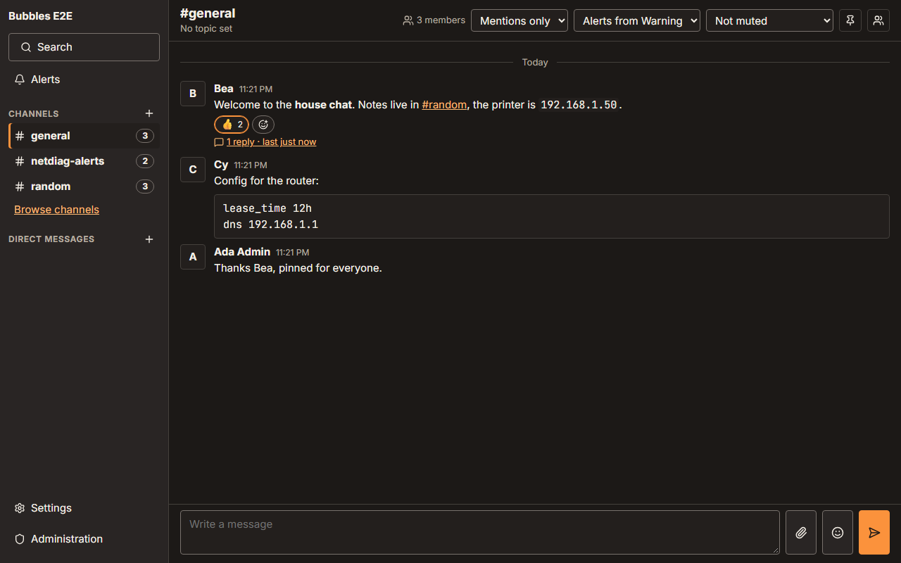
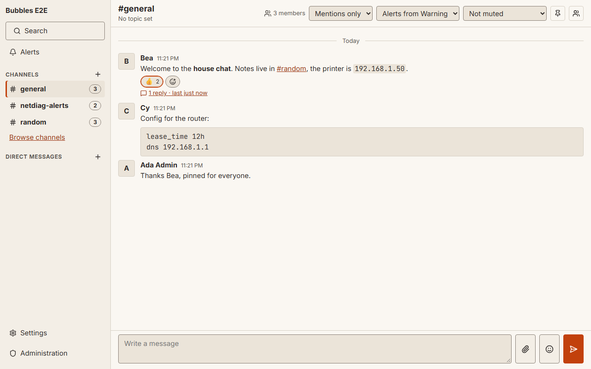
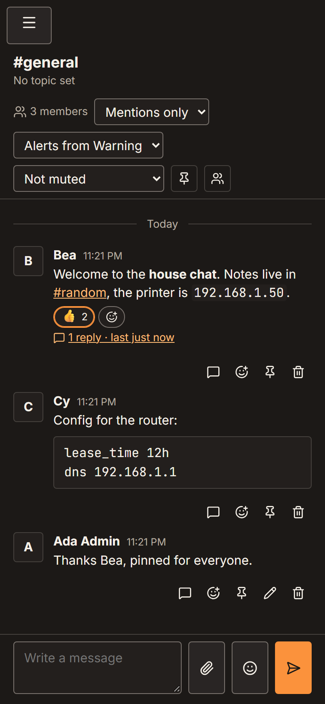
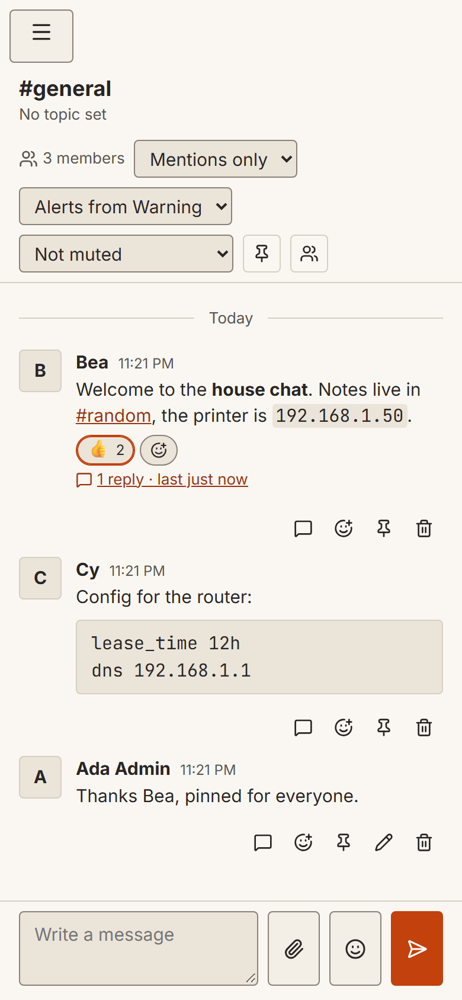

# bubbles

A secure, self-hosted chat platform for a local network. One server binary runs
on any LAN host, and every device joins through the web app or the desktop tray app.

bubbles needs no internet connection and no cloud account. It is a companion to
[netdiag](docs/netdiag.md): LAN tools post alerts ("printer offline", "gateway
down") that everyone on the network sees, and people chat in channels, DMs and
group DMs with files and photos.

## What it does

- **Chat:** public and private channels, DMs and group DMs, threads, reactions,
  mentions (`@user`, `@channel`, `@here`), pins, edit and delete, full-text search,
  unread counts and drafts that sync across devices, presence and typing.
- **Files:** upload by button, drag and drop or paste. Images, video and audio show
  inline. EXIF location data is removed from JPEG, PNG and WebP.
- **Alerts and integrations:** alerts with severity and acknowledgement, incoming
  webhooks (native JSON and a Slack-compatible subset), scoped app tokens, a
  realtime event stream, a Go SDK (`pkg/bubblesclient`) and an MCP server for
  agents.
- **Admin:** invitations with roles, settings, audit log, encrypted backups,
  TLS and CA management, and a reset that clears content or does a factory reset.
- **Everywhere:** one server binary for Windows, macOS and Linux (amd64 and arm64),
  a Docker image, and an installable web app for phones and computers.

All app traffic is HTTPS, with a certificate from a local certificate authority
that each device trusts once. See [docs/security.md](docs/security.md) for the
threat model and what bubbles does not protect against.

## Screenshots

Screenshots of the login page, a channel and the admin overview, in dark and
light themes on desktop and phone sizes, are generated by
[`web/tests/e2e/screenshots.spec.ts`](web/tests/e2e/screenshots.spec.ts) into
`docs/img/` (run with `BUBBLES_SCREENSHOTS=1`). The files are named
`<screen>-<theme>-<size>.png`, for example:

| Dark, desktop | Light, desktop | Dark, phone | Light, phone |
| --- | --- | --- | --- |
|  |  |  |  |

Login (`login-*`) and the admin overview (`admin-overview-*`) follow the same
naming.

A tour with more screens (alerts, threads, search, invites, reset, phones) is on the
[project site](https://donaldsteele.github.io/bubbles/). Its screenshots come from
[`web/tests/e2e/showcase.spec.ts`](web/tests/e2e/showcase.spec.ts) (run with
`BUBBLES_SHOWCASE=1`), and the page itself lives in `site/`.

## Quick start

1. Download the zip for your system from the project's releases page, and check
   the file against `SHA256SUMS`.
2. Unzip it and run the server on a computer that stays on your network. See
   `HOW-TO-OPEN.txt` for the warnings that Windows (SmartScreen) and macOS
   (Gatekeeper) show for unsigned programs.
3. Read the console. It shows the admin account (`admin`) and its generated
   password, plus the addresses to open, for example `https://192.168.1.20:28225`.
   The password is also saved in `admin-password.txt` in the data directory.
4. Open that address in a browser on the server and sign in as `admin` with that
   password. Then change the password.
5. Let people join. On a Windows, macOS or Linux computer, use the desktop tray
   app: it finds the server and lets people create an account. On a phone, open
   the onboarding page on port 28226 (for example `http://192.168.1.20:28226`),
   install the local CA once, then tap **Create your account**. Or scan the QR
   code the admin shows. [docs/onboarding.md](docs/onboarding.md) has the steps
   for iPhone, iPad, Android, Windows, macOS, Linux and Firefox.
6. Sign-up is open to anyone on your network, and it closes by itself after a
   day. Reopen it in Admin > Settings whenever you need it, or add people with
   an invitation link.

The default ports are 28225 (HTTPS) and 28226 (onboarding). Ports 8443 and 8080 are
used by many other servers and dev tools, so bubbles avoids them: 28225 and 28226 sit in
an IANA-unassigned block (28201-28239), below the Linux ephemeral range (32768-60999)
and the Windows/macOS ephemeral range (49152+), and clear of common LAN-party game
ports. 28225 spells "BUBBL" on a phone keypad.

The default data directory is `%LOCALAPPDATA%\bubbles` on Windows,
`~/Library/Application Support/bubbles` on macOS and `$XDG_DATA_HOME/bubbles` (or
`~/.local/share/bubbles`) on Linux. Override it with `--data-dir`.

Common flags, all also available as `BUBBLES_*` environment variables:
`--https-addr`, `--http-addr`, `--mdns-name` (default `bubbles`, shown as
`bubbles.local`), `--no-mdns`, `--tls-cert` and `--tls-key`, `--tls-extra-dns`, `--tailscale-cert`,
`--allow-public`. Run `bubbles serve -h` for the list.

## Docker

The image is multi-arch (linux/amd64 and linux/arm64), built on
distroless and runs as a non-root user with data in `/data`.

```sh
docker compose -f deploy/docker/docker-compose.yml up -d --build
```

The compose file uses host networking so that mDNS (`bubbles.local`) works. A
bridge-network alternative with published ports is included as a comment, but
mDNS does not work there; devices use the IP address instead.

Without compose, using a released image:

```sh
docker run -d --name bubbles --network host -v bubbles-data:/data \
  ghcr.io/donaldsteele/bubbles:<version>
docker logs bubbles          # admin password and addresses
```

The admin password is printed in the container log on first start. It is never
written to the log files.

Use a bind mount (for example `-v "$PWD/bubbles-data:/data"`) if you want the
database and files on the host. The container's health check runs
`bubbles healthcheck`.

## Run as a service

```sh
bubbles service install
bubbles service start
bubbles service status
```

Windows runs bubbles as a Windows service with a firewall rule on the Private
network profile only. macOS uses a LaunchDaemon, and Linux a systemd unit
(`deploy/systemd/bubbles.service`). Details: [docs/admin.md](docs/admin.md#running-as-a-service).

## Raspberry Pi

A Raspberry Pi makes a good always-on bubbles server: a Pi 4 or 5 (or a
Zero 2 W for a small group) running 64-bit Raspberry Pi OS. Any 64-bit Linux
machine works the same way. Over SSH:

```sh
curl -LO https://github.com/donaldsteele/bubbles/releases/download/v0.4.0/bubbles-v0.4.0-linux-arm64.zip
unzip bubbles-v0.4.0-linux-arm64.zip bubbles
sudo install -m 755 bubbles /usr/local/bin/
sudo bubbles service install
sudo journalctl -u bubbles -n 20     # the addresses and the admin password
```

The service runs as a `bubbles` user with its data in `/var/lib/bubbles` (the
first admin password is also in `/var/lib/bubbles/admin-password.txt`), starts at
boot and restarts when it stops. Install the binary outside your home folder,
as above: the unit cannot read `/home`. The Docker image is multi-arch too, so
the [Docker](#docker) commands work on a Pi as they are. Back it up with
`bubbles backup` (see [Backup and restore](#backup-and-restore)).

## Over Tailscale

With [Tailscale](https://tailscale.com/) on the server and your devices,
bubbles is reachable from anywhere on your tailnet, with no port forwarding
and no public server. bubbles already treats tailnet addresses
(`100.64.0.0/10`, `fd7a:115c:a1e0::/48`) as private, includes the server's 100.x
address in its certificate, and re-issues the certificate when Tailscale
connects after the server started.

- **By address:** open `https://100.101.102.103:28225/` (the server's Tailscale
  address) on any device that installed the bubbles CA.
- **By MagicDNS name, local CA:** a CA created while the server was already on
  the tailnet permits the server's MagicDNS name (only that name, not all of
  `ts.net`), so `https://chat-pi.tail1234.ts.net:28225/` works too. An older CA
  does not cover it; the banner and the admin Security page say so.
- **By MagicDNS name, no CA install:** start the server with
  `--tailscale-cert` (or `bubbles service install --tailscale-cert`). bubbles then
  fetches the certificate Tailscale issues for its MagicDNS name with
  `tailscale cert`, renews it, and serves it to connections for that name, while
  every other address keeps the local CA. Devices on the tailnet open the
  MagicDNS address without installing anything. It needs HTTPS certificates
  turned on for the tailnet (Tailscale admin console, DNS), and the name then
  appears in the public Certificate Transparency logs. When bubbles runs as a
  service (not root), let it fetch certificates once with
  `sudo tailscale set --operator=bubbles`.

Tailscale does not carry mDNS, so a server on the tailnet does not show up in
the tray app's list or as `bubbles.local`: type its MagicDNS name or 100.x address.
The tray app accepts the Tailscale certificate for a `*.ts.net` name. Web push
keeps working wherever the phone is, as long as the server can reach the
browser push services.

## Connect netdiag and other apps

- **Go SDK:** `pkg/bubblesclient` handles pairing, CA pinning, a reconnecting
  event stream and a coalescing alert queue, so a flapping device cannot flood the
  channel.
- **Pairing:** the app asks to pair, and an admin approves the request after
  comparing the code and CA fingerprint.
- **Webhooks:** any tool that can post a webhook (Uptime Kuma, Grafana, Home
  Assistant) can post into a channel without changes.

See [docs/integrations.md](docs/integrations.md) and [docs/netdiag.md](docs/netdiag.md).

## MCP

The MCP server lets Claude and other agents read channels, post messages, and list,
post and resolve alerts with an app token (acknowledging is for people). Run the stdio
bridge with:

```sh
bubbles mcp --conn "bubbles://192.168.1.20:28225/?token=<app-token>&fp=sha256:<ca-fingerprint>"
```

The token is read from the connection string or `BUBBLES_CONN` and is never
printed. See [docs/mcp.md](docs/mcp.md).

## Backup and restore

```sh
bubbles backup --out bubbles.bbk --passphrase-file passphrase.txt
bubbles restore bubbles.bbk --passphrase-file passphrase.txt
```

Backups are encrypted by default. `--no-encrypt` writes the CA private key in
plaintext, so avoid it. Restore refuses a non-empty data directory unless you pass
`--force`. Details: [docs/admin.md](docs/admin.md#backups).

## Reset

The admin **Danger zone** (and `bubbles reset` on the console) has two actions:

- **Clear content** deletes messages, files, pictures, alerts and event history.
  It keeps users, channels, apps, webhooks and settings.
- **Factory reset** wipes everything and creates a new `admin` account with a new
  generated password, shown once on the reset-complete screen and printed on the
  console. Sign-up opens again for its window. It keeps the CA by default, so
  devices stay trusted. **Generate new
  CA** destroys the old CA key, and attendees must install the new one.
  **Keep server settings** carries settings over.

Both need the admin password and the instance name typed. Both offer an encrypted
backup first. Erasure is not forensic-grade on SSDs; see
[docs/security.md](docs/security.md#reset-and-erasure-limits).

## Build

Requires Go 1.26.9 or newer and Node 26.

```sh
npm --prefix web ci
npm --prefix web run build      # writes internal/webui/dist (embedded in the server)
go build ./cmd/bubbles
```

Release archives for all six targets (windows, darwin, linux on amd64 and arm64):

```sh
bash scripts/build.sh           # or: scripts/build.ps1 on Windows
```

## Development

```sh
npm --prefix web run dev        # Vite dev server
npm --prefix web run check      # svelte-check, eslint, prettier
npm --prefix web run test       # Vitest
go test ./...
```

## Module path

The Go module is `github.com/donaldsteele/bubbles`. A fork that publishes under
its own path runs `scripts/set-module-path.ps1 -Module github.com/<owner>/bubbles` once.

## License

Apache-2.0. See LICENSE and NOTICE.
