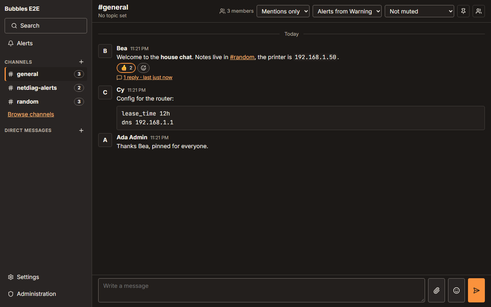
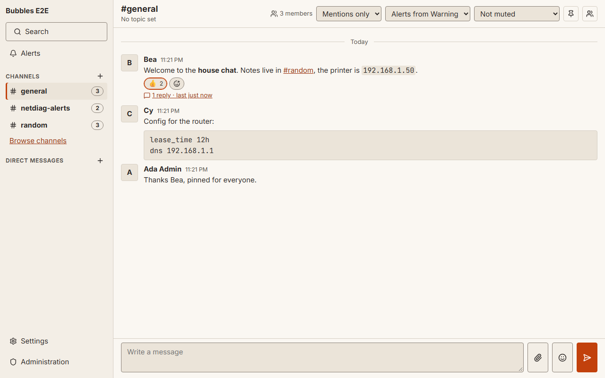
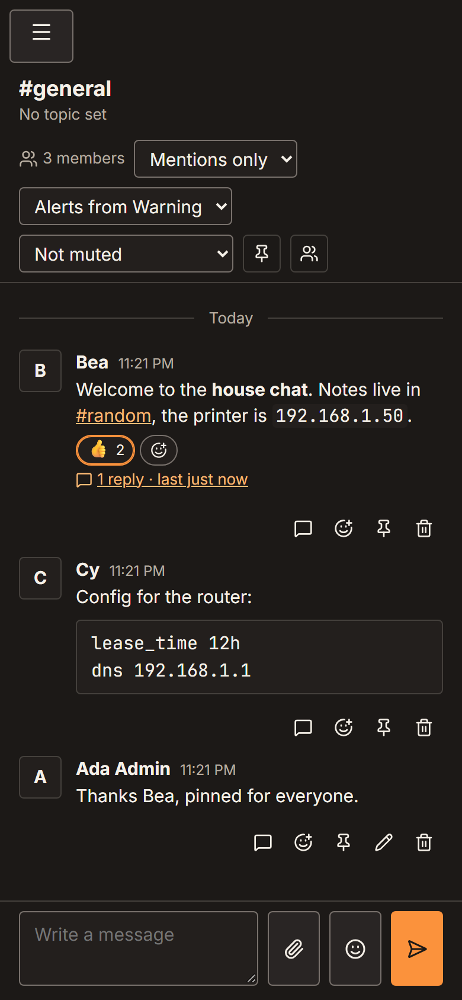
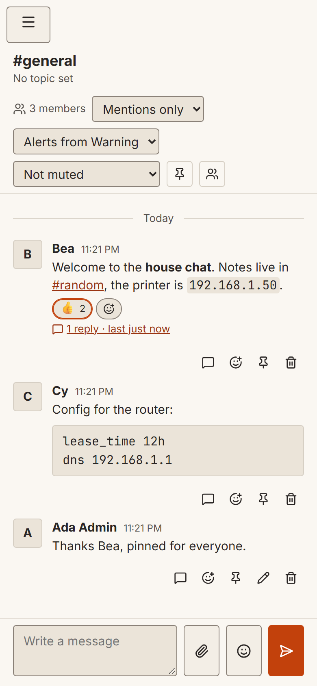

# bubbles

A secure, self-hosted chat platform for a local network. One server binary runs
on any LAN host, and every device joins through the web app or the desktop tray app.

bubbles needs no internet connection and no cloud account. It is a companion to
[netdiag](docs/netdiag.md): LAN tools post alerts ("printer offline", "gateway
down") that everyone on the network sees, and people chat in channels, DMs and
group DMs with files and photos.

## What it does

- **Chat:** public and private channels, DMs and group DMs, threads, reactions,
  mentions (`@user`, `@channel`, `@here`), pins, edit and delete, full-text search,
  unread counts and drafts that sync across devices, presence and typing.
- **Files:** upload by button, drag and drop or paste. Images, video and audio show
  inline. EXIF location data is removed from JPEG, PNG and WebP.
- **Alerts and integrations:** alerts with severity and acknowledgement, incoming
  webhooks (native JSON and a Slack-compatible subset), scoped app tokens, a
  realtime event stream, a Go SDK (`pkg/bubblesclient`) and an MCP server for
  agents.
- **Admin:** invitations with roles, settings, audit log, encrypted backups,
  TLS and CA management, and a reset that clears content or does a factory reset.
- **Everywhere:** one server binary for Windows, macOS and Linux (amd64 and arm64),
  a Docker image, and an installable web app for phones and computers.

All app traffic is HTTPS, with a certificate from a local certificate authority
that each device trusts once. See [docs/security.md](docs/security.md) for the
threat model and what bubbles does not protect against.

## Screenshots

Screenshots of the login page, a channel and the admin overview, in dark and
light themes on desktop and phone sizes, are generated by
[`web/tests/e2e/screenshots.spec.ts`](web/tests/e2e/screenshots.spec.ts) into
`docs/img/` (run with `BUBBLES_SCREENSHOTS=1`). The files are named
`<screen>-<theme>-<size>.png`, for example:

| Dark, desktop | Light, desktop | Dark, phone | Light, phone |
| --- | --- | --- | --- |
|  |  |  |  |

Login (`login-*`) and the admin overview (`admin-overview-*`) follow the same
naming.

## Quick start

1. Download the zip for your system from the project's releases page, and check
   the file against `SHA256SUMS`.
2. Unzip it and run the server on a computer that stays on your network. See
   `HOW-TO-OPEN.txt` for the warnings that Windows (SmartScreen) and macOS
   (Gatekeeper) show for unsigned programs.
3. Read the console. It prints the setup token and the addresses to open, for
   example `https://192.168.1.20:8443`.
4. Open that address in a browser on the server, enter the setup token and create
   the administrator account.
5. Add other devices. Open the onboarding page on port 8080 (for example
   `http://192.168.1.20:8080`), install the local CA once, then scan the QR code
   or open the address. [docs/onboarding.md](docs/onboarding.md) has the steps
   for iPhone, iPad, Android, Windows, macOS, Linux and Firefox.

The default ports are 8443 (HTTPS) and 8080 (onboarding). The default data
directory is `%LOCALAPPDATA%\bubbles` on Windows, `~/Library/Application Support/bubbles`
on macOS and `$XDG_DATA_HOME/bubbles` (or `~/.local/share/bubbles`) on Linux.
Override it with `--data-dir`.

Common flags, all also available as `BUBBLES_*` environment variables:
`--https-addr`, `--http-addr`, `--mdns-name` (default `bubbles`, shown as
`bubbles.local`), `--no-mdns`, `--tls-cert` and `--tls-key`, `--tls-extra-dns`,
`--allow-public`. Run `bubbles serve -h` for the list.

## Docker

The image is multi-arch (linux/amd64 and linux/arm64), built on
distroless and runs as a non-root user with data in `/data`.

```sh
docker compose -f deploy/docker/docker-compose.yml up -d --build
```

The compose file uses host networking so that mDNS (`bubbles.local`) works. A
bridge-network alternative with published ports is included as a comment, but
mDNS does not work there; devices use the IP address instead.

Without compose, using a released image:

```sh
docker run -d --name bubbles --network host -v bubbles-data:/data \
  ghcr.io/donaldsteele/bubbles:<version>
docker logs bubbles          # setup token and addresses
```

Use a bind mount (for example `-v "$PWD/bubbles-data:/data"`) if you want the
database and files on the host. The container's health check runs
`bubbles healthcheck`.

## Run as a service

```sh
bubbles service install
bubbles service start
bubbles service status
```

Windows runs bubbles as a Windows service with a firewall rule on the Private
network profile only. macOS uses a LaunchDaemon, and Linux a systemd unit
(`deploy/systemd/bubbles.service`). Details: [docs/admin.md](docs/admin.md#running-as-a-service).

## Connect netdiag and other apps

- **Go SDK:** `pkg/bubblesclient` handles pairing, CA pinning, a reconnecting
  event stream and a coalescing alert queue, so a flapping device cannot flood the
  channel.
- **Pairing:** the app asks to pair, and an admin approves the request after
  comparing the code and CA fingerprint.
- **Webhooks:** any tool that can post a webhook (Uptime Kuma, Grafana, Home
  Assistant) can post into a channel without changes.

See [docs/integrations.md](docs/integrations.md) and [docs/netdiag.md](docs/netdiag.md).

## MCP

The MCP server lets Claude and other agents read channels, post messages and
acknowledge alerts with an app token. Run the stdio bridge with:

```sh
bubbles mcp --conn "bubbles://192.168.1.20:8443/?token=<app-token>&fp=sha256:<ca-fingerprint>"
```

The token is read from the connection string or `BUBBLES_CONN` and is never
printed. See [docs/mcp.md](docs/mcp.md).

## Backup and restore

```sh
bubbles backup --out bubbles.bbk --passphrase-file passphrase.txt
bubbles restore bubbles.bbk --passphrase-file passphrase.txt
```

Backups are encrypted by default. `--no-encrypt` writes the CA private key in
plaintext, so avoid it. Restore refuses a non-empty data directory unless you pass
`--force`. Details: [docs/admin.md](docs/admin.md#backups).

## Reset

The admin **Danger zone** (and `bubbles reset` on the console) has two actions:

- **Clear content** deletes messages, files, pictures, alerts and event history.
  It keeps users, channels, apps, webhooks and settings.
- **Factory reset** wipes everything and returns to the setup wizard with a new
  setup token. It keeps the CA by default, so devices stay trusted. **Generate new
  CA** destroys the old CA key, and attendees must install the new one.
  **Keep server settings** carries settings over.

Both need the admin password and the instance name typed. Both offer an encrypted
backup first. Erasure is not forensic-grade on SSDs; see
[docs/security.md](docs/security.md#reset-and-erasure-limits).

## Build

Requires Go 1.26.9 or newer and Node 26.

```sh
npm --prefix web ci
npm --prefix web run build      # writes internal/webui/dist (embedded in the server)
go build ./cmd/bubbles
```

Release archives for all six targets (windows, darwin, linux on amd64 and arm64):

```sh
bash scripts/build.sh           # or: scripts/build.ps1 on Windows
```

## Development

```sh
npm --prefix web run dev        # Vite dev server
npm --prefix web run check      # svelte-check, eslint, prettier
npm --prefix web run test       # Vitest
go test ./...
```

## Module path

The Go module is `github.com/donaldsteele/bubbles`. A fork that publishes under
its own path runs `scripts/set-module-path.ps1 -Module github.com/<owner>/bubbles` once.

## License

Apache-2.0. See LICENSE and NOTICE.
